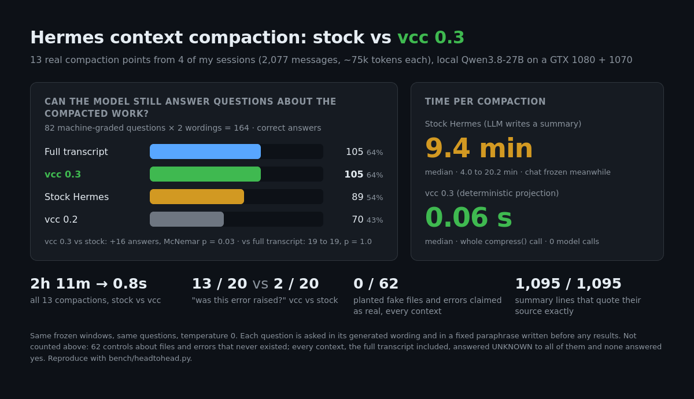

# hermes-vcc-engine

**Context compaction for [Hermes Agent](https://github.com/NousResearch/hermes-agent) that takes milliseconds instead of minutes, and doesn't lose anything.**

Hermes compacts a long conversation by asking an LLM to summarize the old turns. This plugin replaces that LLM call with a deterministic projection of the transcript: what you asked, what ran, what failed, what got fixed, which files changed. Every line points back to the message it came from, so the agent can open the original whenever it needs a detail.



| | stock Hermes (LLM summary) | **vcc 0.3** |
|---|---|---|
| Time per compaction, local 27B | 9.4 minutes median (4 to 20), chat frozen | **0.06 seconds** |
| Model answers questions about the compacted work | 89 / 164 | **105 / 164** |
| Same questions with the full, uncompacted transcript | | **105 / 164 vs 105 / 164** |
| Summary lines that quote their source exactly | not checkable | **933 / 933** |
| Pointers that open the original message | none | **436 / 436** |
| Extra model calls | 1 per compaction | **0** |

Measured on 13 real compaction points from my own sessions. Every number here comes from a script in this repo that you can rerun against yours.

## Install

```bash
hermes plugins install danbiocchi/hermes-vcc-engine --enable
hermes config set context.engine vcc
```

Restart whatever runs Hermes (CLI, gateway, web UI) and look for `Using context engine: vcc` in the agent log. Needs Hermes 0.21.7 or newer, and nothing else.

To go back: `hermes config set context.engine compressor`.

## Why I built it

I run Hermes on a local Qwen 27B split across a GTX 1080 and a 1070. Every compaction froze the chat while the model wrote prose. In the benchmark below, stock Hermes took 4 to 20 minutes per compaction, 2 hours 11 minutes for all 13. Twice in daily use the "summary" came back longer than what it replaced.

vcc did the same 13 compactions in 0.8 seconds in total, about 9,000x faster at the median.

## What a compaction looks like

```
## Goal
The build in ~/proj is red, please fix it and keep the public API unchanged.

## Errors & Fixes
- [#1001] terminal `cd ~/proj && pytest -q` — ERROR exit 1: E ImportError: cannot import name 'parse' from 'proj.core' 1 failed → fixed at [#1008]

## Error Names Seen
Named errors that appeared in tool output:
- ImportError (first at [#1002])

## Relevant Files
Every file read or changed with a file tool in this part of the session; terminal commands may have touched others.
- /home/u/proj/proj/core.py — read; modified (patched)

## Commands Run
- `cd ~/proj && pytest -q` — failed (exit 1), then succeeded (exit 0)

## Detailed Session Log (oldest first)
[#1000] user: The build in ~/proj is red, please fix it and keep the public API unchanged.
[#1001] → terminal: `cd ~/proj && pytest -q`
[#1002] ← terminal ERROR exit 1: E ImportError: cannot import name 'parse' from 'proj.core' 1 failed
[#1003] → read_file: `/home/u/proj/proj/core.py`
[#1005] → patch: `/home/u/proj/proj/core.py`
[#1007] → terminal: `cd ~/proj && pytest -q`
[#1008] ← terminal exit 0: 48 passed in 1.2s
[#1009] assistant: Fixed: 'parse' was renamed to '_parse' in core.py. All 48 tests pass.
```

Each `[#N]` is a real message id. `session_search(session_id=..., around_message_id=N)`, which Hermes already has, returns the original in full. Old messages stop being re-sent on every request but stay in `state.db`.

Hermes then adds its own sections as usual: the anchor index, your messages verbatim, and the recovery note. On later compactions the previous projection gets merged instead of summarized again, so the original goal survives any number of passes.

## The evidence

### 1. The model can answer questions about the compacted work

`bench/headtohead.py` takes my sessions from `state.db` and cuts them where Hermes would actually compact them, at 75% of a 98k context. That gave 13 compaction points, about 75k tokens each. Each one was compacted by stock Hermes (its own summary prompt, on my local model) and by vcc. Then the model got the same machine-graded questions about each: was this file changed, did this command succeed, was this error raised, name a file that was changed. Every question was asked twice, once as generated and once in a fixed paraphrase written before any results, so a score can't come from matching the summary's wording.

| context given to the model | correct | of 164 |
|---|---:|---:|
| full transcript, no compaction | 105 | 64% |
| **vcc 0.3** | **105** | **64%** |
| stock Hermes summary | 89 | 54% |
| vcc 0.2 | 70 | 43% |

- **vcc 0.3 vs stock:** vcc got 32 right that stock missed, stock got 16 that vcc missed (McNemar exact test, p = 0.03).
- **vcc 0.3 vs the full transcript:** 19 to 19, p = 1.0. No detectable loss on this set. That doesn't prove the two are identical; with 164 answers the margin is about ±7 points.
- **Paraphrased wording only:** vcc 50, full transcript 48, stock 39 (of 113 each).
- **Not counted:** 62 control questions about files and errors that never existed. Every context, the full transcript included, answered UNKNOWN to all of them. None claimed a fake file or error was real.

By question type:

| question | full transcript | **vcc 0.3** | stock | vcc 0.2 |
|---|---:|---:|---:|---:|
| was this file changed? | 54 / 68 | **47 / 68** | 50 / 68 | 34 / 68 |
| was this error raised? | 2 / 20 | **13 / 20** | 2 / 20 | 1 / 20 |
| did this command succeed? | 24 / 24 | **20 / 24** | 16 / 24 | 12 / 24 |
| name a file that was changed | 24 / 26 | **25 / 26** | 21 / 26 | 23 / 26 |
| what was the first request? | 1 / 26 | **0 / 26** | 0 / 26 | 0 / 26 |

The last row's grading wants exact keywords and fails in every context, so it doesn't separate anything.

**What changed from 0.2 to 0.3.** The 0.2 summaries already contained the facts; the model just couldn't use them, and answered UNKNOWN 153 times out of 226. Four changes, all deterministic:

1. **Plain words.** Files were tagged `patched` or `written`, and a small model doesn't connect that to "was it modified?". They now read `modified (patched)` and `written (created or overwritten)`.
2. **Command outcomes.** Commands were listed without results. Each now says what happened, e.g. `failed (exit 1), then succeeded (exit 0)`. Command questions went from 12 to 20 of 24.
3. **Error names.** Error names were buried in the log. A short "Error Names Seen" section lists each with where it first appeared. Error questions went from 1 to 13 of 20, ahead of both stock and the full transcript.
4. **Less carried-over prose.** A pre-vcc summary inherited from an earlier compaction could take up 35% of the budget. It's now capped at 15%.

### 2. It doesn't make anything up

```
faithfulness         933 / 933   ██████████████████████████████  100%
negative control      17 /  17   ██████████████████████████████  100%
reference integrity  436 / 436   ██████████████████████████████  100%
```

- **Faithfulness:** for every log line, the role, tool and exit code match the message it cites, and every word and number in its excerpt appears verbatim in that message.
- **Negative control:** plant an invented word in a log line and the same check must catch it. It caught 17 of 17, so the clean pass above means something.
- **Reference integrity:** every `[#N]` that vcc wrote into the real summaries in my `state.db`, opened through Hermes's own `session_search`, returns the right message.

CI runs the same proofs on generated transcripts, with no private data, on every push (1,095 of 1,095 lines).

### 3. What survives inside the summary itself

Factory's [compression evals](https://factory.com/news/evaluating-compression) found that tracking which files got touched was the weakest area of every compressor they measured. Across 17 of my sessions, each compacted to its configured budget, including one 1.96M-character session squeezed 83x into a single summary:

| | kept in the summary |
|---|---:|
| files modified | 41 / 45 |
| commands run | 205 / 269 |
| user requests | 73 / 80 |
| errors from calls that really failed | 3 / 3 |

Anything past the caps is still in `state.db` and one `session_search` away.

### 4. Speed

Whole summary step, median of 7 runs:

```
1,486 messages    v0.1 ██████████████████████████████  325 ms
                  v0.2 ██████████████                  150 ms
                  v0.3 ██████████████▏                 154 ms

whole corpus      v0.1 ██████████████████████████████ 1046 ms
4,509 messages    v0.2 ██████████████████▍             641 ms
                  v0.3 ███████████████████             663 ms
```

v0.3 costs 3% more than v0.2 for the new sections, and is still 1.6x faster than v0.1. For scale, the stock LLM call it replaces took 240,000 to 1,210,000 ms on the same machine.

**Test setup:** 17 real sessions (2,844 messages) plus seeded stress transcripts for the proofs and timings, 13 real compaction points for the head-to-head, run on a Ryzen 5 2600X with the Python 3.14 that ships with Hermes and Qwen3.8-27B IQ3_S across a GTX 1080 and a 1070, temperature 0.

## Is it for you?

**Yes** if you run Hermes on a local or slow model, or your sessions are long and full of tool calls.

**Probably not** if you're on a frontier API where compaction already takes a couple of seconds and you like the model's narrative summary.

Trying it costs little. If a projection ever throws, that one pass falls back to the normal LLM summary. If a Hermes update changes something the engine depends on, it notices at startup and behaves exactly like the stock compressor. Rolling back is one command.

## Limits

- It quotes, it doesn't reason. There's no "Key Decisions" section, because that takes judgement.
- Lines get `[#N]` pointers only when Hermes hands the engine messages that already have database ids. Messages that aren't saved yet get positional `[tN]` labels, which `session_search` can't open.
- Recall depends on the agent actually calling `session_search` when it needs a detail. The compaction note tells it to, but that's an instruction, not a guarantee.
- Every compaction rewrites the prompt, so the prompt cache resets. The summary is kept small (6% of the window by default) to keep the re-read cheap.
- `plugins.isolation: host` is untested. In-process, the default, is what it's built and tested against.

## How it hooks in

The engine subclasses Hermes's own `ContextCompressor` and overrides one method, `_generate_summary`. Everything else is stock Hermes: when to compact, what to keep verbatim, tool call and result pairing, the session-DB archive, cancellation and secret redaction. It registers through `ctx.register_context_engine` with no monkeypatching, and `hermes plugins validate` passes with a clean security scan.

## Safety

No network, no file I/O, no subprocesses, no `eval`. The projector is pure stdlib Python.

Tool output is treated as untrusted data: ANSI escapes, control and bidi characters are stripped; chat-template markers (`<|im_start|>`, `[INST]`, `<<SYS>>`, `<think>`) are neutralized; and quoted text can't open a new `##` section. Secrets go through Hermes's own `_redact_compaction_text` before anything is stored. Output size stays bounded whatever the transcript contains, and that's fuzz-tested.

## Config

Optional, under `context.vcc` in `config.yaml`:

```yaml
context:
  engine: vcc
  vcc:
    budget_ratio: 0.06       # summary size as a share of the context window
    min_budget_tokens: 1500
    max_budget_tokens: 8000
    fallback_to_llm: true    # if a projection ever fails, use the stock summary for that pass
    fast_anchors: true       # build Hermes's anchor index the fast way; false uses Hermes's builder
```

Your usual `compression:` settings (threshold, threshold_tokens, protect_first_n, protect_last_n, tail_mode, model_thresholds) are honored exactly as the built-in compressor honors them.

<details>
<summary>Tip: let the trigger follow your context window</summary>

If you set `compression.threshold_tokens` back when your context was smaller, delete it. Without it the trigger follows `model.context_length` at 75% of the usable window, so it adjusts itself when you change context. Note that `model.context_length` only pins your default model; other models auto-detect, and on a llama.cpp router that can resolve to the GGUF's native window rather than your actual `n_ctx`. A per-route `custom_providers` entry with `context_length` fixes that.
</details>

## Reproduce the numbers

```bash
PY=~/.hermes/tools/python-*/bin/python3          # the interpreter Hermes itself uses

$PY -I bench/proofs.py   --synthetic               # proofs on generated data, no Hermes or GPU needed
$PY -I bench/proofs.py                             # faithfulness, negative control, retention, references on your state.db
$PY -I bench/bench.py    --write-golden            # freeze inputs, record output hashes
$PY -I bench/bench.py    --check-golden            # timings plus byte-identity against the golden
$PY -I bench/headtohead.py freeze                 # cut your sessions where Hermes would compact
$PY -I bench/headtohead.py stock                  # stock summaries on your model; slow
$PY -I bench/headtohead.py variant vcc            # vcc summaries from this checkout
$PY -I bench/headtohead.py ask FULL STOCK vcc     # questions under each; needs the GPU
$PY -I bench/headtohead.py report                 # scores, McNemar, timings
```

None of the scripts print transcript text, only scores, counts and hashes. Frozen inputs, summaries and answers stay in `~/.cache/hermes-vcc-engine/` at mode 0600, never in the repo.

<details>
<summary>How v0.2 got 2x faster without changing a byte of output</summary>

`bench/bench.py --check-golden` proved it: all 126 outputs hashed the same as v0.1 on frozen inputs.

Profiling real compactions put the time somewhere I didn't expect. On the biggest session, half of it was Hermes's anchor index running regexes over every character of the compacted region. A quarter was the projector, mostly regex passes plus `isinstance` checks against `typing.Mapping`.

- Text cleanup runs each rewrite step only when the text could contain what that step rewrites: an ANSI sequence needs an ESC, a chat marker needs `<` or `[`. Whitespace collapses with `split()` and `join` instead of a regex. Tests check the character tables against the old regexes across all 1,114,112 code points.
- Error detection was a case-insensitive regex. Every alternative in it is a fixed phrase or starts at a fixed word, so the text is lowercased once and the regex runs only where one of those words occurs. Lowercasing is exact unless the text contains one of the four non-ASCII characters that fold onto ASCII letters (`İ ı ſ K`, found by exhaustive scan), in which case the original regex runs. That's about 13x faster on real tool output.
- Hermes's anchor patterns are all line-local and each needs a literal (`.py`, `fix/`, `Error`, `http`), so each pattern only scans lines that contain its literal. Commit hashes have no literal, so those lines are found with a `bytes.translate` hex mask. Dense text falls back to a full scan. The result is checked against Hermes's own builder at startup and on the first real compaction of every process, and any difference turns the fast path off.
- Then the small stuff: `dict` fast paths, slotted dataclasses, and not copying multi-megabyte tool results just to look at their first character.

Tried and not shipped: dropping the second redaction pass (Hermes's redactor isn't idempotent, so removing it would have meant less redaction), CPython 3.14's JIT (no measurable difference, since the hot paths are already C), and shrinking the summary format (only 3.4% of summary tokens are exact duplicates, and the tokenizer charges the same for `→` as for `->`).
</details>

<details>
<summary>Research notes</summary>

- [The Complexity Trap](https://arxiv.org/abs/2508.21433) (JetBrains and TUM): simply masking old tool output performs about as well as LLM summarization for SWE agents at roughly half the cost. Deterministic projection is in the same family as masking, with pointers back to the original.
- Factory's [compression evals](https://factory.com/news/evaluating-compression): tracking which files were touched was the weakest area for every method they tested, and they argue for measuring tokens per task rather than per request. That's why this keeps exact paths and commands.
- [LLMLingua-2](https://arxiv.org/abs/2403.12968) and similar prompt compressors drop tokens using a small model and lose a lot of accuracy outside their training domain. That's the wrong trade when exact identifiers are the point.
- Chroma's [context rot](https://research.trychroma.com/context-rot) and [Lost in the Middle](https://arxiv.org/abs/2307.03172) are why the summary stays small and the newest material stays at the end.
- [NoLiMa](https://arxiv.org/abs/2502.05167): models find facts much less reliably when the question doesn't share words with the text. That's the 0.3 fix: say "modified", not just "patched".
- [Sufficient Context](https://arxiv.org/abs/2411.06037): models abstain or guess depending on whether they think the context is enough. Stating outcomes outright ("failed, then succeeded") turned many of 0.2's UNKNOWN answers into right ones.
- [Quantifying sensitivity to prompt formatting](https://arxiv.org/abs/2310.11324): small format changes swing accuracy by double digits, which is why every format change here is measured on paraphrased questions too.
- Manus's [context engineering notes](https://manus.im/blog/Context-Engineering-for-AI-Agents-Lessons-from-Building-Manus): keep the prefix stable, and make compression restorable. The `[#N]` pointers are the restorable part.
</details>

## Development

```bash
git clone https://github.com/danbiocchi/hermes-vcc-engine && cd hermes-vcc-engine
uv venv --python 3.14 && uv pip install pytest
.venv/bin/python -m pytest -q          # 83 tests; CI runs 3.11 through 3.14
```

Projector tests run anywhere. Engine and anchor tests need a real Hermes checkout (`HERMES_AGENT_DIR`, default `~/.hermes/hermes-agent`) and skip without one. They mock the LLM so the test fails if it's ever called, run full `compress()` passes, compare the fast anchor index against Hermes's own, and load the plugin through Hermes's actual loader. `HERMES_HOME` is sandboxed, so tests never touch your real profile.

Before changing anything that affects output, run `bench/bench.py --write-golden` first and `--check-golden` afterwards.

## License

Apache-2.0. `anchors.py` mirrors the structure of Hermes's anchor index builder (MIT); see [NOTICE](NOTICE). The idea comes from [VCC](https://github.com/lllyasviel/VCC) (arXiv 2603.29678); this is an independent implementation.
