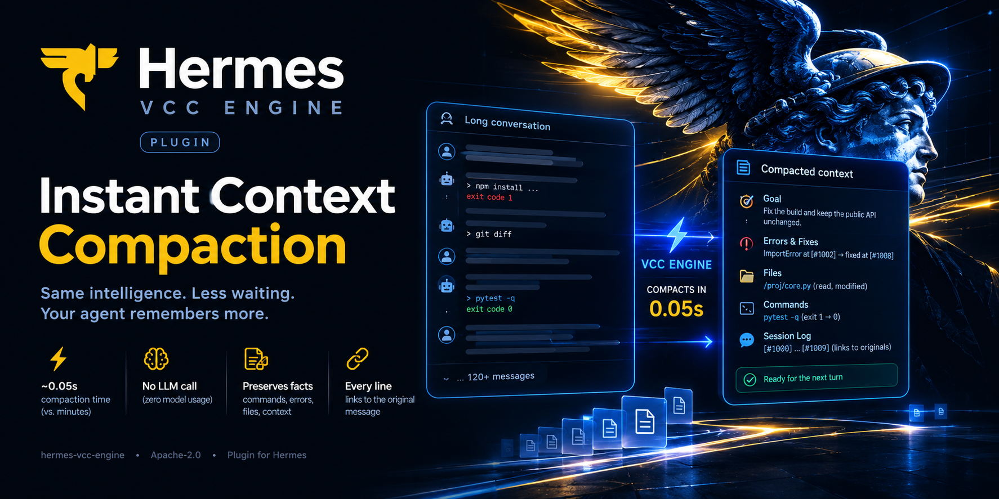
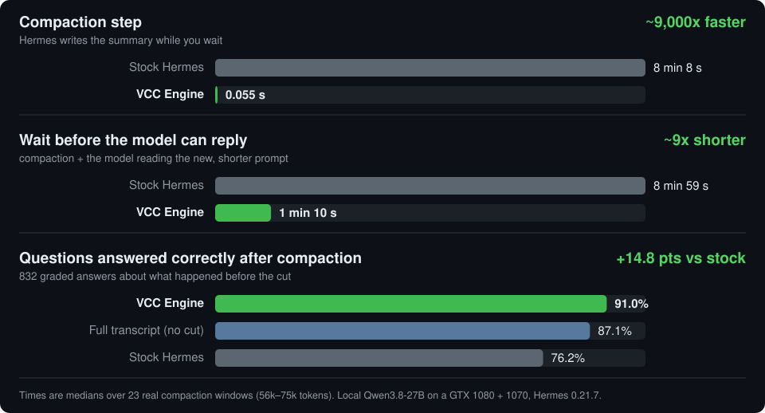
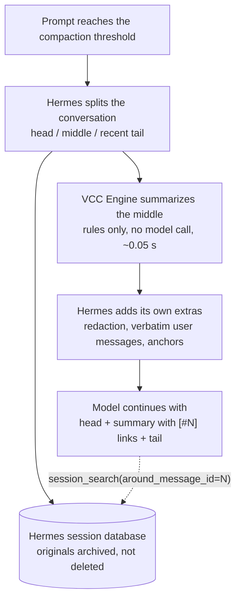
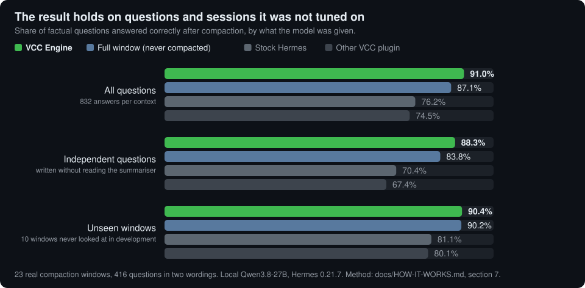
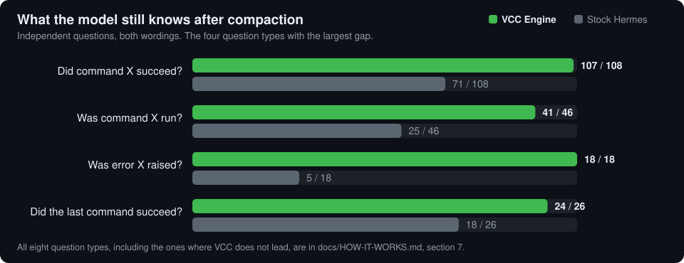

# Instant Context Compactor (Hermes VCC Engine)



[](https://github.com/danbiocchi/hermes-vcc-engine/actions/workflows/ci.yml)
[](LICENSE)


[](https://hits.sh/github.com/danbiocchi/hermes-vcc-engine/)

**Hermes compaction in 0.05 seconds instead of 8 minutes, and the agent remembers more afterwards.**

When a [Hermes Agent](https://github.com/NousResearch/hermes-agent) conversation fills its context window, Hermes stops and asks your model to summarize everything so far. On a local model you wait minutes for that. This plugin builds the summary with fixed rules and no model call. It keeps the exact commands, exit codes, errors and files, and every line links back to the original message.



## Install

```bash
hermes plugins install danbiocchi/hermes-vcc-engine --enable
hermes config set context.engine vcc
```

Restart Hermes (CLI, gateway or web UI). Each compaction now logs `vcc: projected N turns into M chars in X ms (no LLM call)`.

To go back, run `hermes config set context.engine compressor`.

It needs Hermes `0.21.7` or newer and has no dependencies. The tests pass on `v0.21.7`, `v0.22.2`, `v0.22.4`, `v0.22.5` and `v0.23.0`.

## Is it for you?

Yes, if you run Hermes on a local or slow model and long sessions stall every time the context fills up. Yes too if you need the agent to keep facts straight across compactions: which command failed, which error came up, which files it changed.

On a fast cloud API the stock summary already takes seconds, so you gain little speed. You can keep both: set `only_local_models: true` and hosted models get Hermes's normal summary while local ones get this one ([configuration](#configuration)).

## How it works

Hermes compacts by keeping the start and the recent end of the conversation and replacing the middle with a summary. The plugin changes one thing: who writes that summary. Hermes still decides when to compact, what stays verbatim, how tool calls are paired, and how messages are redacted and archived.



The summary is copied from the recorded messages, not written. This is the output for a small test session where the build fails, the agent patches a file, and the tests pass:

```
## Goal
The build in ~/proj is red, please fix it and keep the public API unchanged.

## Errors & Fixes
- [#1001] terminal `cd ~/proj && pytest -q` — ERROR exit 1: E ImportError: cannot import name 'parse' from 'proj.core' 1 failed → fixed at [#1008]

## Relevant Files
- /home/u/proj/proj/core.py — read; modified (patched)

## Commands Run
- `cd ~/proj && pytest -q` — failed (exit 1), then succeeded (exit 0)

## Detailed Session Log (oldest first)
[#1001] → terminal: `cd ~/proj && pytest -q`
[#1002] ← terminal ERROR exit 1: E ImportError: cannot import name 'parse' from 'proj.core' 1 failed
[#1005] → patch: `/home/u/proj/proj/core.py`
[#1008] ← terminal exit 0: 48 passed in 1.2s
```

Each `[#N]` is the id of the original message. Nothing is deleted: Hermes archives the originals, and the agent can open any of them in full with `session_search`. On the next compaction the previous summary is merged, so the goal and the file and command lists carry forward.

The sample is shortened. The [full output](docs/HOW-IT-WORKS.md#a-worked-example), the [step-by-step walk through `compress()`](docs/HOW-IT-WORKS.md#3-what-vcc-changes-inside-hermes) and the [reasons it is fast](docs/HOW-IT-WORKS.md#4-why-it-is-faster) are in [docs/HOW-IT-WORKS.md](docs/HOW-IT-WORKS.md).

## The evidence

All numbers come from real Hermes sessions on real hardware: Qwen3.8-27B (IQ3_S, llama.cpp) on a GTX 1080 + GTX 1070, with version 0.4.0 of the plugin.

The recall test took 23 real compaction windows and asked the model 416 machine-graded questions about what happened before the cut, each in two wordings. The model saw the exact message list Hermes sends after compaction.



The lead over stock Hermes is +14.8 points (95% CI +10.7 to +19.1, p < 0.001). It holds on questions written without reading the summarizer, and on windows never looked at during development.



| | Stock Hermes | VCC Engine |
|---|---:|---:|
| Summary step, median | 488 s (2 of 23 runs hit Hermes's 15-minute limit) | **0.055 s** |
| Wait before the model can start replying, median | 539 s | **70 s** |
| Model calls per compaction | 1 long generation | **0** |
| Same input gives the same summary | No | **Yes** |
| Session-log lines whose words all appear in the cited message | not applicable | **937 / 937** |
| `[#N]` links that open the right message | not applicable | **436 / 436** |

What these numbers don't show:

- They come from one user's sessions and one local model. Yours may differ.
- The questions are factual. They don't test whether the agent finishes its next task, and they don't ask about decisions or reasoning, which is what an LLM summary is written to capture.
- The +3.8 point lead over never compacting is not statistically significant (p = 0.10). Read it as "about as good as the full transcript".
- The wait is 9x shorter, not 9,000x, because the model still has to read the new prompt after any compaction.

Every table, the statistics, the question types where VCC doesn't lead, and nine threats to validity are in [section 7 of HOW-IT-WORKS](docs/HOW-IT-WORKS.md#7-how-it-is-tested-and-how-to-reproduce-it).

## Configuration

Everything is optional. The keys go under `context.vcc` in `config.yaml`.

| Key | Default | Effect |
|---|---|---|
| `budget_ratio` | `0.06` | Summary size as a share of the context window |
| `min_budget_tokens` | `1500` | Smallest summary budget |
| `max_budget_tokens` | `8000` | Largest summary budget |
| `fallback_to_llm` | `true` | If the summary raises an error, use Hermes's stock summary for that pass |
| `fast_anchors` | `true` | Build Hermes's anchor index with a faster builder that is checked against Hermes's own |
| `only_local_models` | `false` | Use vcc only while the chat model runs locally; hosted models get Hermes's stock summary |

You can also switch hosted models from any chat with `/vcc on`, `/vcc off` and `/vcc default`. Local models always use vcc.

Ranges, how the budget is computed, what counts as a local model, and the `/vcc` details are in [section 8](docs/HOW-IT-WORKS.md#8-configuration).

## Security and privacy

- The runtime code makes no network calls and starts no subprocesses. It uses the Python standard library only, with no telemetry.
- It reads Hermes's config and writes one file: a single boolean in `<HERMES_HOME>/vcc_state.json`, when you use `/vcc`.
- It never modifies or deletes session messages.
- Tool output is treated as data. Control characters and chat-template markers are stripped, and quoted text can't open a new section. Fuzz tests cover this.
- If a Hermes internal it depends on is missing after an update, the engine runs as the stock compressor and logs a warning.

The full list, including the private Hermes internals the engine relies on, is in [section 9](docs/HOW-IT-WORKS.md#9-security-and-privacy). To report a problem, see [SECURITY.md](.github/SECURITY.md).

## Limitations

- It quotes and doesn't reason. There are no Key Decisions or rationale sections, so reasons survive only as excerpts of what the assistant wrote.
- "Fixed" means the identical call later succeeded. A fix that used a different command isn't paired with the failure.
- The summary is capped (40 files, 25 commands, the newest log lines that fit). Anything dropped is still in Hermes's database.
- The `[#N]` links help only if the agent calls `session_search`.
- The prompt cache still resets after a compaction, as it does with stock Hermes.

[Section 6](docs/HOW-IT-WORKS.md#6-what-it-gives-up) covers each of these in detail.

## Benchmarks and development

```bash
git clone https://github.com/danbiocchi/hermes-vcc-engine && cd hermes-vcc-engine
uv venv --python 3.14 && uv pip install pytest
.venv/bin/python -m pytest tests -q          # 142 tests; CI runs Python 3.11 to 3.14

PY=$(ls -d ~/.hermes/tools/python-*/bin/python3 | head -1)
$PY -I bench/proofs.py --synthetic           # faithfulness checks, CPU only
$PY -I bench/bench.py --check-golden         # timings; fails if any output byte changed
```

You can rerun the full head-to-head on your own sessions and model. It takes hours, and your sessions never leave your machine. The commands are in [To reproduce](docs/HOW-IT-WORKS.md#to-reproduce).

Version history is in [docs/CHANGELOG.md](docs/CHANGELOG.md). Known problems and planned work are in [docs/BACKLOG.md](docs/BACKLOG.md).

## Research background

The plugin is an independent, Hermes-specific implementation of the idea in [*View-oriented Conversation Compiler for Agent Trace Analysis*](https://arxiv.org/abs/2603.29678) (VCC, Lvmin Zhang and Maneesh Agrawala): compile an agent trace into a shorter view whose lines keep stable references to the full trace. It is not the authors' compiler, and the numbers on this page are this project's own. [Section 2](docs/HOW-IT-WORKS.md#2-the-idea-from-the-vcc-paper-and-how-this-plugin-adapts-it) explains what was adapted, with the related work.

## License

Apache-2.0. `vcc/anchors.py` mirrors the structure of Hermes's anchor index builder (MIT); see [vcc/NOTICE](vcc/NOTICE).
